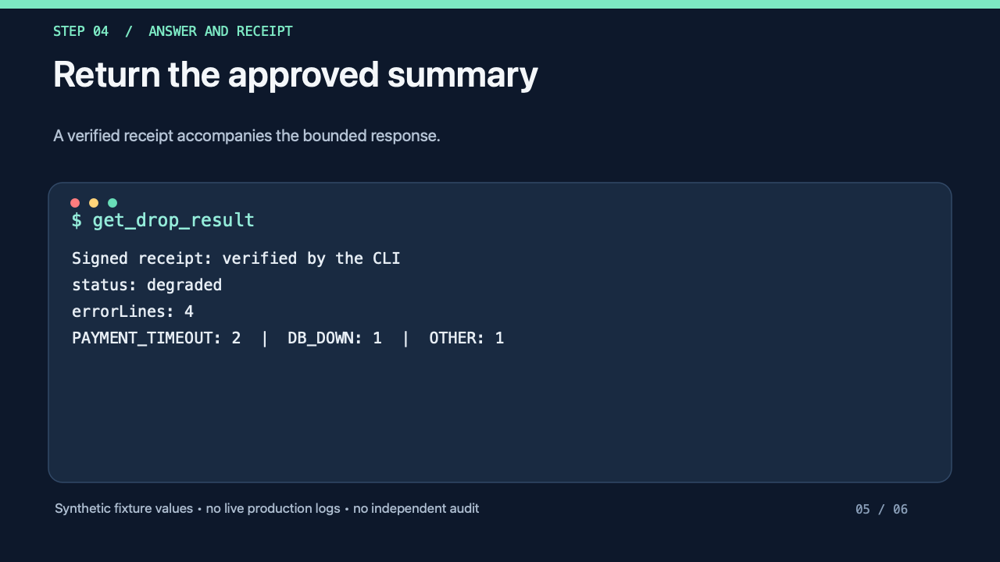

# drop

**Get the answer, not the access.**

[Français](README.fr.md)

[](https://github.com/memolabs-dev/drop/actions/workflows/test.yml)
[](https://scorecard.dev/viewer/?uri=github.com/memolabs-dev/drop)
[](LICENSE)

drop is a consent layer for questions between AI agents. Your agent needs something that lives in a colleague's tools: a repository, a design file, production logs. Instead of asking for access, it sends a bounded question over MCP or A2A. The colleague who owns the source sees who asks and why, and approves that one answer. The work runs on the owner's machine, and only the approved answer goes back.

**The promise.** Your data stays on your machine. Only an answer you approved leaves it, encrypted, to the person who asked for it.

**Its limit.** drop controls what goes through drop. An MCP connector or a model that the owner chooses can have its own data flows, and drop does not see them.

`drop` is a code name; the product name is not chosen yet.

## Status

drop is an early prototype. Read this before you evaluate it.

- **No real users yet.** Every demo ran on the maintainer's machines. The need itself is still being measured.
- **The Mac app** (menu bar, Apple Silicon) builds signed and notarized, but there is no public release or download yet. Acceptance on a clean Mac and VoiceOver testing are still open.
- **Windows and Linux apps** are in progress and not available.
- **No independent security audit.** Two anti-replay hardening changes still wait for their formal review.
- No stable version, no npm package, no compatibility promise. `main` moves fast.

The dated progress report is [docs/AVANCEMENT.md](docs/AVANCEMENT.md) (in French) and the ordered task index is [docs/TASKS.md](docs/TASKS.md) (in French).

## How it works

<picture>
  <source media="(prefers-color-scheme: dark)" srcset="docs/diagrams/one-question-dark.svg">
  
</picture>

1. The owner publishes a **capability**: a contract that fixes the input, the output schema, the tools allowed, the budget and who approves. Nothing is shared by default.
2. The requester's agent picks a capability from the team catalog and asks a question with a stated purpose.
3. The owner decides once: allow once, deny or not now. No answer before expiry means no run.
4. The owner's node runs the capability with the tools fixed in advance. The model never decides permissions.
5. The output is validated against its schema and passed through a secret scanner. Invalid output is rejected, not repaired. For a sensitive capability, the owner reviews the answer, can remove fields, then sends or discards it.
6. The requester receives the answer. Both sides keep a signed receipt with hashes and metadata, never the content.

A longer walkthrough with diagrams is in [the guide](docs/GUIDE.md) (in French).

## See the consent experience

These two **real interface screenshots** are from a [documented maintainer-only pilot, 8 October 2026](docs/demo/README.md). They show what approval and outbound-answer review look like; they are **not** a claim of external usability or a completed independent security audit.

| 1. Approve a limited request | 2. Review the response before sending |
| --- | --- |
| [](docs/demo/README.md) | [](docs/demo/README.md) |
| **Allow once, deny or defer.** The card says why access is requested and what is excluded. | **Send only approved fields.** The owner can remove fields and refuse the outgoing answer. |

[Read the full dated two-actor demo and its observed limitations](docs/demo/README.md). The demo was performed on the maintainer's machines; a new independent user journey, clean-machine acceptance and public installer are still outstanding.

## What exists today

Everything below is on `main` and covered by tests. Task IDs refer to [docs/TASKS.md](docs/TASKS.md).

- **Protocol.** Ed25519 identities and signatures, X25519 encryption (`crypto_box` from libsodium), zod schemas for every message, anti-replay checks, signed receipts (T1.1, T1.2).
- **Capabilities.** `production.error_summary` summarizes logs without any model. `repo.answer` answers about a repository from an allowlisted temporary copy. `mcp.answer` answers from an MCP server the owner already uses, with read-only tools chosen at publish time. `a2a.answer` relays to an approved internal A2A agent (T1.7, T1.13, T2.2, T2.15).
- **Two exchanges without a model.** The owner can answer by hand, with text or a text file, under the same consent and receipt (T4.3). The owner can publish signed facts with an audience and an end date, served without a new decision (T4.4).
- **Requester side.** A stdio MCP server with six tools, including `ask_team` for plain-language questions to the team and `request_drops` for several owners at once (T1.10, T2.10, T2.12). The team is also reachable as an A2A v1.0 agent, and every A2A task goes through consent (T2.14).
- **Agent onboarding.** Thirteen MCP clients are detected and connected automatically on macOS, Windows and Linux, keeping the comments and layout of their config files. A configuration to copy only appears as an explained fallback when drop cannot write (T3.3, T4.5, T4.22).
- **Private profile.** Created by `drop init` and by the app: explicit network destinations, no cloud fallback, a local model endpoint with no model preselected, and the owner pays for their own model (T3.1).
- **Three ways to connect, none imposed.** Local network discovery over mDNS, internet through iroh (a separate Rust program, off by default), or a relay your team runs (T4.2, T4.2b). The relay only sees encrypted envelopes and routing metadata.
- **Enterprise pack.** A signed organization policy enforced on each workstation and on the relay, plus a Docker image and a Helm chart for the relay (T4.10).
- **Mac menu bar app.** Tauri 2, consent cards, field-by-field review, confirmed invitations (T4.14). Signed and notarized builds exist for Apple Silicon; there is no public download (T3.4).
- **blocked-observer.** A small local tool that measures how often coding agents get blocked by something another person owns. It is how the need is being measured (T0.1 to T0.6).

The consumer gateway in `packages/gateway` (remote MCP for hosted assistants) is deferred and refused by the private profile.

## Quick start for developers

You need Node 22.18 or later (CI uses Node 24) and pnpm 11.27.0, the version pinned in `package.json`.

```bash
git clone https://github.com/memolabs-dev/drop.git
cd drop
pnpm install --frozen-lockfile
pnpm -r lint
pnpm -r typecheck
pnpm -r test
```

The tests use fixtures and simulated model providers. They need no API key and no network service.

### Local demo

[](docs/demo/offline-consent-e2e-20261025.mp4)

[**Watch the 42-second keyless CLI walkthrough**](docs/demo/offline-consent-e2e-20261025.mp4) · [**Reproduce and read the evidence limits**](docs/demo/offline-proof-20261025.md)

The clip reconstructs the **actual output of a local scripted test**, not a live UI recording. The owner's decision was scripted, and no external usability or security certification is implied.

```bash
# Local, deterministic and keyless; no external LLM calls or Keychain access
bash scripts/demo-local.sh --offline

# Optional second scenario with an explicitly provided key
OPENROUTER_API_KEY=your-key bash scripts/demo-local.sh
```

The script starts a relay and three nodes on `127.0.0.1` (ports 7790 to 7793) in a temporary directory, then plays two scenarios through the requester's MCP server:

- **Production error summary.** Runs without any model or key: request, approval, result, receipts and a leak check.
- **A question about a colleague's repository** (`repo.answer`). This part calls a remote model through OpenRouter and needs `OPENROUTER_API_KEY`. Without a key, or with `--offline`, the script exits successfully after the deterministic approval/result/receipt/leak-check scenario. The script never searches macOS Keychain for an API key; the networked example requires an explicitly supplied variable.

The demo nodes use the historical profile (`--profile legacy`), so it does not demonstrate the private profile. The script output is in French. To run a private setup by hand, follow [the private profile guide](docs/PRIVATE_PROFILE.md) (in French).

### Connect your own agent

```bash
node packages/node/src/cli.ts init --name Alice --relay ws://127.0.0.1:7780/v1
node packages/node/src/cli.ts serve
node packages/node/src/cli.ts help
```

Agent setup, manual MCP configuration and the thirteen supported clients are described in [docs/ONBOARDING.md](docs/ONBOARDING.md) and [packages/requester-mcp/README.md](packages/requester-mcp/README.md) (both in French).

## Repository layout

<picture>
  <source media="(prefers-color-scheme: dark)" srcset="docs/diagrams/architecture-overview-dark.svg">
  
</picture>

How the desktop app, the node and the interface fit together is described in [docs/ARCHITECTURE.md](docs/ARCHITECTURE.md) (in French).

| Path                        | What it holds                                                                  |
| --------------------------- | ------------------------------------------------------------------------------ |
| `packages/protocol`         | zod schemas, identity, signatures, encryption, receipts                        |
| `packages/relay`            | WebSocket routing and admission                                                |
| `packages/node`             | Identity, CLI, orchestration, local API and panel, agent detection and install |
| `packages/runner`           | Execution pipeline, budgets and output checks                                  |
| `packages/capabilities`     | Deterministic, repository, MCP and A2A capabilities                            |
| `packages/requester-mcp`    | Stdio MCP server that talks to the local node API                              |
| `packages/a2a`              | Inbound A2A adapter                                                            |
| `packages/blocked-observer` | Local measurement of the need                                                  |
| `packages/simulation`       | Local bench with simulated nodes                                               |
| `packages/gateway`          | Optional consumer gateway, deferred                                            |
| `packages/desktop-ui` | React + shadcn/ui interface shown inside the desktop app |
| `apps/desktop` | Tauri 2 desktop shell for macOS, Windows and Linux |
| `crates/drop-iroh`          | Internet connectivity through iroh                                             |
| `deploy/helm`               | Helm chart for the relay                                                       |
| `openspec/`                 | Specifications (the contract) and change history                               |
| `docs/`                     | Guide, decisions, task index, product documents                                |

## Security model

These rules hold in the code and in every contribution:

- A request from a peer is untrusted data. It is validated with zod and passed to the model as framed data, never as instructions.
- The capability fixes the tools before the model is called. The model never widens the authorization boundary.
- File reads use an allowlist, inside a temporary copy.
- Every output is validated against the capability's schema and scanned for secrets before it leaves.
- Logs, receipts and telemetry hold hashes and metadata, never secrets or content.
- The runner listens on no port. Nodes connect out to the relay; the local API and panel listen on loopback.
- Private keys live in `~/.drop/` with mode `0600`.

Known limits: encryption and the secret scanner do not prove that nothing can leak. A delivered answer cannot be recalled. The catalog reveals who knows what. Several partial answers can add up. Owners may start approving by reflex. Connectors, models and A2A agents the owner chooses are part of the boundary to review.

Report vulnerabilities privately, as described in [SECURITY.md](SECURITY.md).

## Documentation

Internal documentation is written in French.

- [Guide](docs/GUIDE.md): the journey, the demo, what stays private (in French)
- [Product requirements](docs/product/PRD.md): target, promise and its limit, hypotheses (in French)
- [Vision](openspec/project/vision.md) and [architecture](openspec/project/architecture.md) (in French)
- [Architecture](docs/ARCHITECTURE.md): where each part of the repository lives and where each build comes from (in French)
- [Specifications](openspec/specs/): the normative contract, with acceptance scenarios (in French)
- [Decisions](docs/DECISIONS.md): every product and technical decision with its reason (in French)
- [Open source and business model](docs/OPEN_SOURCE.md) (in French)

## Roadmap

[docs/TASKS.md](docs/TASKS.md) (in French) is the single source for order and dependencies. Next steps, in short: close the pending security reviews, finish the Mac app, ship Windows and Linux apps, a one-link invitation to join a team, then a trial with pairs of colleagues who actually work together. Public launch, packages and the product name come after.

<picture>
  <source media="(prefers-color-scheme: dark)" srcset="docs/diagrams/roadmap-phases-dark.svg">
  
</picture>

The one-link join is a target flow, still in progress (T4.23):

<picture>
  <source media="(prefers-color-scheme: dark)" srcset="docs/diagrams/join-two-clicks-dark.svg">
  
</picture>

## Contributing

Contributions are welcome. Start with [CONTRIBUTING.md](CONTRIBUTING.md) and the [Code of Conduct](CODE_OF_CONDUCT.md). Questions go to [GitHub Discussions](https://github.com/memolabs-dev/drop/discussions); see [SUPPORT.md](SUPPORT.md).

## License

Copyright 2026 Guillaume Flambard. Licensed under the [Apache License, Version 2.0](LICENSE). See [NOTICE](NOTICE). Third-party components and model weights keep their own licenses.
